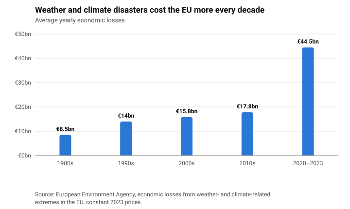
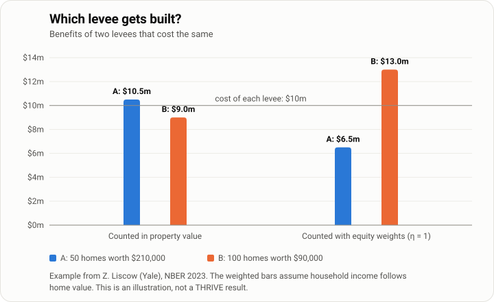
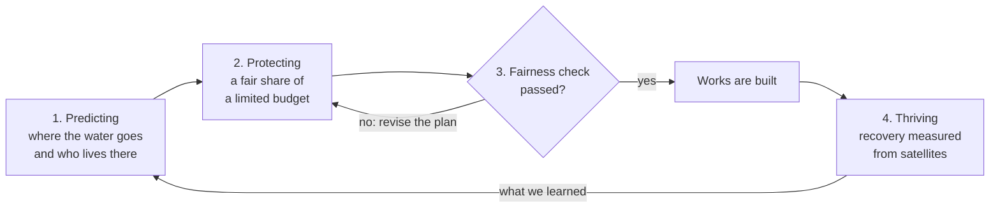
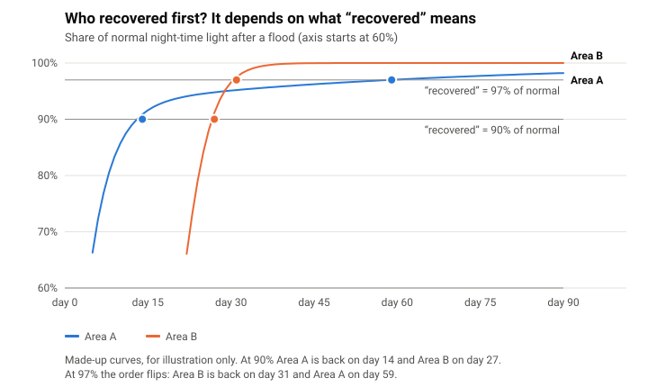
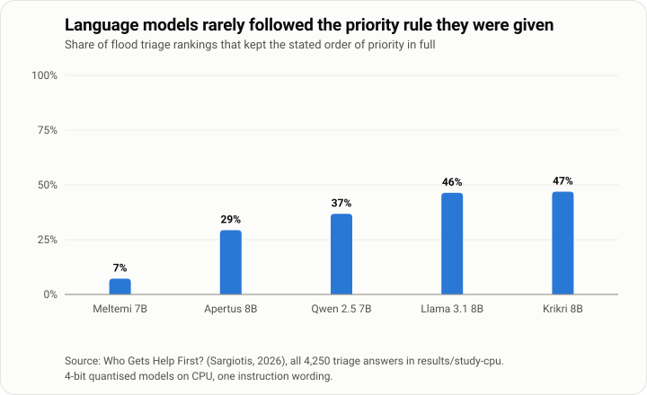

# THRIVE

**Trustworthy Hazard-to-Recovery Intelligence for Vulnerability-aware Equity**

**Dimitrios Sargiotis** · National Technical University of Athens · [users.ntua.gr/dims](https://users.ntua.gr/dims/) · [uomoathens.github.io](https://uomoathens.github.io/)

**[Try the interactive version →](https://uomoathens.github.io/thrive/)**

THRIVE is the companion software to the book *AI for Resilient Cities: Predicting, Protecting, and Thriving in a Changing Climate* (Springer, Cham, 2027, [link.springer.com/book/9783032364166](https://link.springer.com/book/9783032364166)). It takes the three verbs in the title and turns each into a question.

Predicting asks where the next flood will hit and who lives there. Protecting asks who gets protected first when the money for flood works runs out, as it always does. Thriving is the question most systems skip. After the water goes down, which neighbourhoods are back on their feet within weeks, and which are still waiting months later?

THRIVE answers the three in a loop, so that what we learn after one flood changes how we spend before the next.

## Status


Version 0.4.1 holds the four core calculations, each with its own tests, and two pipelines for real data. Phase A, on US flood grants, has run on GitHub and its results are in `results/phase-a` (summary below). Phase B, on Storm Daniel in Thessaly, is new in this version; it runs on GitHub and writes to `results/phase-b`. The calculations are checked on worked examples, which give exactly the numbers on the interactive page. The charts below show published figures or simple examples, and each caption says which.

To try it:

```
pip install -e ".[dev]"
pytest
thrive demo
```

`thrive demo` runs the three worked examples of this page: the two levees, the two recovery curves, and the fairness check on three made-up decision rules. `thrive info` lists the steps of the loop and the frameworks of the book each one builds on, and `thrive cite` prints the citation of the book.

### What the code does today

| Module | What it does | Where it comes from |
| --- | --- | --- |
| `thrive.recovery` | Finds the day an area is back to a share of normal, optionally for several days in a row, and keeps a finding about who recovered first only if it holds under every threshold | “Recovery is measured” below |
| `thrive.weights` | Equity weights and the point where a decision changes | “People count” below |
| `thrive.allocate` | Chooses which works to fund within a budget, with equity weights, and reports how unevenly protection falls across groups. One plan per value of η, so a council can compare them | “People count” below, with the group-fairness measure of FCFL (Table 5.8) |
| `thrive.fairness` | The group-fairness measure of FCFL | FCFL (Table 5.8) |
| `thrive.data.phase_a` | Phase A: downloads FEMA's hazard-mitigation grants and the National Risk Index, and compares flood money with flood risk across five groups of counties, from least to most socially vulnerable | “How we will test it”, phase A |
| `thrive.data.phase_b` | Phase B: downloads the Copernicus flood maps of Storm Daniel and the 2021 census on the 1 km grid, and counts how many residents, and how many aged 65 and over, lived inside the mapped flood in each regional unit of Thessaly | “How we will test it”, phase B |
| `thrive.audit` | The fairness check: changes one detail at a time, compares with a placebo run, and passes a plan only if, after Holm correction across all checks, no identity change moves it and every need change raises it | “Need may count” and “Nothing is built before a fairness check” below, method of Who Gets Help First? |

Still to come: the forecasting and vulnerability models of the Predicting step, the satellite data for recovery, learning the allocation policy with Proximal Policy Optimization, federated learning across towns, and the validation phases.

## The problem

Disasters are getting more expensive. In the EU, weather and climate extremes such as floods, storms, heatwaves and droughts cost €8.5 billion a year on average in the 1980s. Between 2020 and 2023 the yearly average was €44.5 billion.

<picture>
  <source media="(prefers-color-scheme: dark)" srcset="docs/figures/eu-losses-dark.svg">
  
</picture>

In the United States, studies find that the money for protection is shared out in a way that tends to favour the richer side of town. Flood-mitigation projects funded by FEMA must pass a benefit-cost test, and the benefits it counts are mostly the property value a project protects. Zachary Liscow of Yale gives a simple example. Two levees cost $10 million each. Levee A protects 50 homes worth $210,000, so it saves $10.5 million and passes. Levee B protects 100 homes worth $90,000. It saves $9 million and fails, though it protects twice as many homes.

Economists have a fix called equity weights: a dollar saved counts for more when the household that saves it has less. In our illustration, which assumes income follows home value, the weights turn the result around.

<picture>
  <source media="(prefers-color-scheme: dark)" srcset="docs/figures/two-levees-dark.svg">
  
</picture>

Europe has noticed the problem. The proposed European Climate Resilience Law (COM(2026) 730, 27 October 2026) defines *just resilience* and asks every national climate-resilience plan to take into consideration people in vulnerable situations and the regions hit hardest. As we read the text, it sets out no method for checking that a plan does this. THRIVE is meant to give a public authority that check. If a system like it is classed as high-risk under the AI Act, the same check also documents the examination for possible bias that Article 10 requires.

## How the loop works



Each step builds on frameworks from the book:

| Step | Frameworks of the book it builds on |
| --- | --- |
| Predicting | HEFF-RC (Table 1.6), LSTM-AFFUW (Table 1.7), AIF-EWS (Table 1.8), VAE-LVM (Table 4.8) |
| Protecting | EA-CURA (Table 3.5), FCFL (Table 5.8), DPFL-EDA (Table 1.5) |
| Fairness check | The audit method of [Who Gets Help First?](https://github.com/uomoathens/who-gets-help-first) |
| Thriving | A new step that extends the social-impact feedback layer of EA-CURA |

## What THRIVE adds

### Recovery is measured, and no single definition of it is trusted

Satellites can see a town come back to life. Lights return at night (NASA Black Marble), and on farmland the fields turn green again (Sentinel-2). To compare two areas you have to decide what "recovered" means, say 90 % of normal light. That choice matters more than it seems. A 2026 preprint on Winter Storm Uri in Texas, not yet peer-reviewed, found that its answer to "do more vulnerable areas recover more slowly?" flipped when the definition changed.

The invented curves below show how that can happen.

<picture>
  <source media="(prefers-color-scheme: dark)" srcset="docs/figures/recovery-definition-dark.svg">
  
</picture>

THRIVE therefore checks every finding about unequal recovery under a range of thresholds, and keeps it only if it holds under all of them.

### Need may count, identity may not

A person over 80 should move a household up the list. So should a wheelchair user, a baby or a patient on dialysis. A foreign name, a woman's name or a poor postcode should not, once the need is the same. Our earlier audit found open language models breaking this rule in a quiet way: they moved Syrian names and asylum seekers up and areas of villas down, as if identity were a sign of need. THRIVE writes the rule down as a condition that every allocation has to meet.

### People count, not just property

THRIVE uses equity weights inside the allocation itself. How much more a euro counts for a poorer household is a political choice, so THRIVE never fixes the number. It shows an elected council what each choice would mean and leaves the decision to them.

### Nothing is built before a fairness check

Before a plan is used, THRIVE runs it again many times, changing one detail each time: a name, a neighbourhood, a residence status. A placebo run with nothing changed shows how much the plan moves by chance. If any detail moves it more than chance does, the plan fails. It also fails if adding a real need, such as a person over 80, does not move it.

### Small towns can learn without handing over their data

A village of 2,000 people has too little data to train a model on its own. With federated learning it can learn from larger towns while every town keeps its data on its own servers. THRIVE works with areas, the 1 km squares of the 2021 census, so bias can be checked without sensitive personal data.

### A language model explains, and never decides

A language model may help explain a decision to residents. It should not take one. In our earlier study, five small open models (7 to 8 billion parameters, run in 4-bit form) were given a clear priority rule for flood calls, and most of the time they did not keep it. Larger models may behave differently, and that is still to be tested.

<picture>
  <source media="(prefers-color-scheme: dark)" srcset="docs/figures/priority-rule-dark.svg">
  
</picture>

## How we will test it

| Phase | Where | Data | Status |
| --- | --- | --- | --- |
| A | United States, fully open | OpenFEMA HMA Subapplications (which replaced the Hazard Mitigation Assistance Projects dataset on 15 October 2026), FEMA National Risk Index v1.20 (flood risk, population, social vulnerability) | First results below, rerun monthly |
| B | Thessaly, Storm Daniel (September 2023) | Copernicus EMS maps EMSR692 and EMSN184, 2021 census on the 1 km grid, Sentinel-2, NASA Black Marble | Exposure pipeline in place (EMSR692 and the census grid); recovery from satellites comes next |
| C | Thessaly, who actually received aid | Anonymised state-aid records by community, requested from the General Secretariat for Natural Disaster Recovery and State Aid | Needs a data request |
| D | Attica, looking ahead | The current plan for flood and wildfire works, assessed before the next event | Later |

### Phase A in plain words

For every US county, Phase A adds up the federal money FEMA has obligated to flood-related hazard-mitigation grants since 2000 and divides it by the county's expected yearly flood loss, inland and coastal, from the National Risk Index. It then sorts the counties into five equal groups by social vulnerability and compares the groups. If protection followed risk alone, every group would get about the same money per dollar of expected loss. The main number is the coverage ratio: money per dollar of risk in the most vulnerable fifth, divided by the same in the least vulnerable fifth. Below 1, the most vulnerable counties get less protection for the same risk. A few very large counties can dominate the totals, so Phase A also computes the ratio without the 20 counties that received the most, and the ratio of the median county. Following THRIVE's own rule, a direction is reported as a finding only when all these measures agree.

Every run first checks that each source answers (`preflight.json`), then records what it downloaded and when (`sources.json`, with a fingerprint of each page), a small sample of the raw records (`sample.json`), the results (`summary.json`, `report.md`, and an Excel file with every county, every activity and every county name it could not match), and its own log. Only grants with a funded status count (closed, approved, obligated, awarded, completed, closeout initiated, subaward accepted), with the obligated amount, or the federal share where an older grant has no obligated amount. A grant counts as flood-related when one of its hazards mentions flooding, it comes from the Flood Mitigation Assistance programme, or its main activity is a flood measure (acquisition, elevation, flood control, floodproofing, drainage), because many flood works are recorded under hurricanes or storms. FEMA names the counties a grant benefits by name, so Phase A matches the names to the National Risk Index; if more than a quarter of the money cannot be matched, the run stops and lists the names.

The limits, stated now: a grant that names several counties is split equally between them, statewide grants are left out, money obligated is not always money spent, and expected loss is a model estimate. We cannot rerun history, so Phase B can show whether the real allocation after Daniel was unequal; comparing it with what THRIVE would have done rests on stated assumptions; and showing that a fairer allocation would also have reduced the damage needs hydraulic models of the floods with and without the works.

### What Phase A found

The first run counted 63,635 FEMA records, kept 16,439 flood-related grants with a funded status, and placed $13.72 billion of them in 3,140 counties. Another $1.90 billion went to statewide grants, which have no county, and $0.51 billion (3.5 % of the money meant for named counties) carried a county name that could not be matched.

| Measure | Coverage ratio, most vulnerable fifth against least vulnerable |
| --- | --- |
| All money | 2.38 |
| Without the 20 counties that received the most (36 % of the money) | 1.53 |
| Median county | 0.85 |
| Median county, among those that received any flood money | 1.11 |

Taken as totals, the most vulnerable counties received more flood money per dollar of risk, not less. The picture is less clear county by county. The typical county in the most vulnerable fifth received a little less than the typical county in the least vulnerable one, and it was more likely to have received nothing at all (14 % of counties against 8 %). The measures do not agree, so by THRIVE's own rule there is **no robust direction** to report. A few places such as New Orleans, Harris County and the New York area, all hit by very large storms, carry the totals.

One record needs checking with FEMA before it is used in any argument: a single Hurricane Sandy grant of $507 million (DR-4085-0018-R) is attributed to Greene County, New York, which makes it the second-largest county in the table.

What we take from this is narrower than a headline. In the United States, the gap does not seem to lie in the national totals, which large disasters dominate; it may lie in which smaller counties never receive any grant. That question needs data on applications as well as awards, and it is where Phase A will go next.

### Phase B in plain words

Phase B asks who was in the water when Storm Daniel hit Thessaly in September 2023. It reads the activation EMSR692 of the Copernicus Emergency Management Service through its public API, downloads every delineation and grading product that can be downloaded, and keeps the layers that map the observed flood, reading each layer once even when a product ships it in two formats. It then lays the flood over Eurostat's 2021 census grid of 1 km squares (version 2.2, January 2025), which gives both the residents and those aged 65 and over in every square. People are taken to be spread evenly over the land part of each square, so a coastal square keeps all its residents and a square whose land is 40 % under water counts 40 % of them as exposed. The results are added up for each regional unit of Thessaly (NUTS 3, EL61): residents, residents exposed, square kilometres flooded, and the share of people aged 65 and over among all residents and among those exposed. If the grid has no age column, the run stops rather than report without it.

What counts as flooded is itself a choice, so Phase B answers the same question three times: with every observed flood polygon, including flood traces where the water had already gone when the image was taken; with standing water only; and with the maximum water extent that Copernicus publishes in the same products. For each it reports the residents exposed and the ratio between the share of people aged 65 and over among those exposed and among all residents, for Thessaly and for each regional unit. Following THRIVE's own rule, a direction is reported as a finding only when all of them agree.

Three checks are written next to the results. The residents on the grid are compared with the official 2021 census figures of ELSTAT for each regional unit. Residents in squares that fall in no regional unit are counted, not dropped silently. And the area of each flood class inside Thessaly is listed, so that anyone can see what each definition adds.

Like Phase A, every run first checks that each source answers, then records each product it found (`inventory.json`), the sources and their fingerprints (`sources.json`), the results (`summary.json`, `report.md`, an Excel file with every regional unit and every flooded square) and the flood extent itself (`flood-extent.gpkg`), so anyone can open it in QGIS. If no flood layer is found, the run stops and the inventory shows what was there.

The limits: the Copernicus maps show the flood the satellites saw on the dates they passed, not the peak; people are assumed to be spread evenly within each square; and being inside the flood is not the same as losing a home. Flash floods that drained within hours, as in Volos and the villages of Pelion, are mostly missing from the satellite maps, so the low figure for Magnesia says little about how hard it was hit.

## The maths, for those who want it

**Recovery equity.** Group $g$ has recovered at threshold $\alpha$ on the first day its light reaches $\alpha$ times its level before the event. The penalty is the spread of recovery times between groups, taken at the worst threshold in the set $\mathcal{A}$:

```math
\tau_g(\alpha)=\min\left\{t:\ \mathrm{NTL}_g(t)\ge \alpha\,\mathrm{NTL}_g^{\mathrm{pre}}\right\},\qquad \Phi_{\tau}=\max_{\alpha\in\mathcal{A}}\ \sum_{g=1}^{G}\left|\tau_g(\alpha)-\bar{\tau}(\alpha)\right|
```

**Need, not identity.** With need $N$ held fixed, changing identity $A$ must not change the decision $\hat{Y}$:

```math
P\left(\hat{Y}_{A\leftarrow a}=y \mid X=x,\ N=n\right)=P\left(\hat{Y}_{A\leftarrow a'}=y \mid X=x,\ N=n\right)\quad \forall\, a,a'
```

**People, not property.** The reward of the allocation policy counts avoided expected annual loss $\Delta\mathrm{EAL}_i$ with an income weight $\omega_i$, and subtracts the recovery penalty. In the current version the allocation is found by exact search over the possible sets of works. Learning it with Proximal Policy Optimization and the group-fairness penalty of FCFL comes in a later step:

```math
R_t=\sum_{i}\omega_i\,\Delta\mathrm{EAL}_i(a_t)-\kappa\,\Phi_{\tau},\qquad \omega_i=\left(\frac{\bar{y}}{y_i}\right)^{\eta}
```

**The fairness check.** A plan is released only if no identity change $c$ moves it beyond the placebo flip rate, and every need change does:

```math
\mathrm{Deploy}\iff \max_{c\in\mathcal{C}_{\mathrm{id}}}\left(\mathrm{FR}_c-\mathrm{FR}_{\mathrm{placebo}}\right)_{\mathrm{UB}_{95}}\le\delta\ \wedge\ \min_{c\in\mathcal{C}_{\mathrm{need}}}\mathrm{Sens}_c\ge\gamma
```

$\mathrm{FR}$ is the share of runs in which the plan changes and $\mathrm{Sens}$ the share of need changes that raise the target's priority. In the code, each check is a test against the threshold ($\delta$ for identity, $\gamma$ for need) with a bootstrap over cases, and all checks together go through Holm correction, so the plan passes only if every one of them does.

## Sources for the charts

- European Environment Agency, *Economic losses from weather- and climate-related extremes in Europe*, 8th EAP headline indicator, 2024.
- Z. Liscow, *Benefit-Cost Analysis and Equity*, NBER, 2023.
- J. W. Lockwood, M. Oppenheimer, N. Lin and J. Gourevitch, *Socioeconomic distributional impacts of evaluating flood mitigation activities using equity-weighted benefit-cost analysis*, Environmental Research Letters, 2024.
- Headwaters Economics, *Improving benefit-cost analyses for rural and low-income communities* (FEMA benefit-cost analysis and property values).
- European Commission, *Proposal for a European Climate Resilience Law*, COM(2026) 730, 27 October 2026, Articles 2(7), 7(1) and 7(2).
- *Spatial Patterns of Post-Storm Recovery Revealed by Nighttime Lights: Evidence from Harris County, Texas*, preprint, Preprints.org, September 2026.
- D. Sargiotis, *Who Gets Help First?*, v1.0.0, 2026, [doi:10.5281/zenodo.23684889](https://doi.org/10.5281/zenodo.23684889), results in `results/study-cpu`.

## Layout

```
README.md          this page
pyproject.toml     package definition
src/thrive/        the THRIVE package: recovery, weights, allocate, fairness, audit, examples, data
tests/             tests, run on every push by GitHub Actions
.github/workflows/ the automatic checks and the Phase A and Phase B runs
docs/index.html    the interactive version, published with GitHub Pages
docs/figures/      the charts on this page, in light and dark versions
docs/og.png        the preview image shown when the page is shared
config/            settings of the data pipelines
results/phase-a/   Phase A results, written by GitHub Actions
results/phase-b/   Phase B results, written by GitHub Actions
CITATION.cff       how to cite this repository and the book
LICENSE            MIT
```

## Citation

The book:

> Sargiotis, D. (2027). *AI for Resilient Cities: Predicting, Protecting, and Thriving in a Changing Climate*. Springer, Cham. ISBN 978-3-032-36416-6 (hardcover), 978-3-032-36417-3 (eBook). https://link.springer.com/book/9783032364166

The related audit:

> Sargiotis, D. (2026). *Who Gets Help First? A counterfactual audit of large language model decisions in flood response* (Version v1.0.0) [Computer software]. Zenodo. https://doi.org/10.5281/zenodo.23684889

See also [CITATION.cff](CITATION.cff).

## Licence

Code: MIT.

## Author

Dimitrios Sargiotis, National Technical University of Athens.
