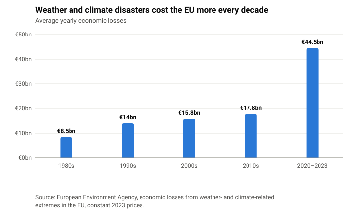
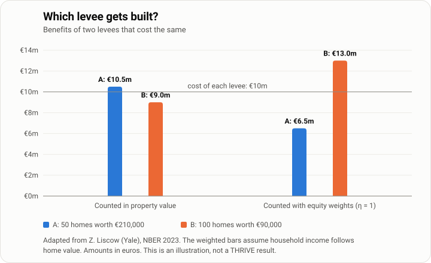
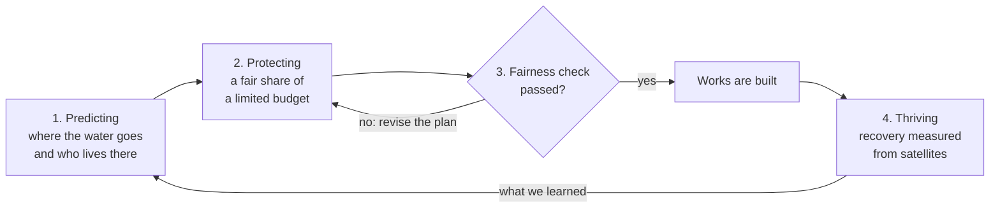
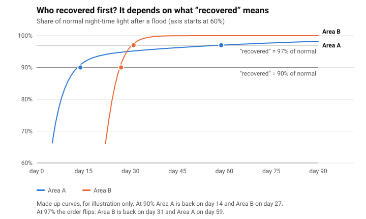
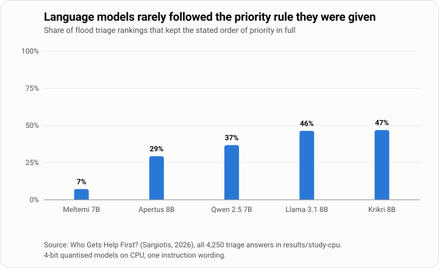

# THRIVE

**Trustworthy Hazard-to-Recovery Intelligence for Vulnerability-aware Equity**

**Dimitrios Sargiotis** · National Technical University of Athens · [users.ntua.gr/dims](https://users.ntua.gr/dims/)

**[Try the interactive version →](https://uomoathens.github.io/thrive/)**

[](https://doi.org/10.5281/zenodo.24170979)

THRIVE is the companion software to the book *AI for Resilient Cities: Predicting, Protecting, and Thriving in a Changing Climate* (Springer, Cham, 2027, [link.springer.com/book/9783032364166](https://link.springer.com/book/9783032364166)). It takes the three verbs in the title and turns each into a question.

Predicting asks where the next flood will hit and who lives there. Protecting asks who gets protected first when the money for flood works runs out, as it always does. Thriving is the question most systems skip. After the water goes down, which neighbourhoods are back on their feet within weeks, and which are still waiting months later?

THRIVE answers the three in a loop, so that what we learn after one flood changes how we spend before the next.

## Status


Version 0.8.0 holds the four core calculations, each with its own tests, and pipelines for real data on Greece, all of which run on GitHub. Phase 1, on who was in the water of Storm Daniel in Thessaly, keeps its results in `results/phase-b`; Phase 2, on how the flooded land of Thessaly came back, in `results/thriving`; and Phase 3, on wildfires, regional growth and Tourism in the 52 regions of Greece, in `results/phase-c`. Phase 4, on heat and street trees in Attica, runs in the companion repository [BUARO](https://github.com/uomoathens/buaro). A summary of each is below, and the figures in this README and on the interactive page are copied from those results automatically after every run. The calculations are checked on worked examples, which give exactly the numbers on the interactive page. The charts below show published figures or simple examples, and each caption says which.

To try it:

```
pip install -e ".[dev]"
pytest
thrive demo
```

`thrive demo` runs the three worked examples of this page: the two levees, the two recovery curves, and the fairness check on three made-up decision rules. `thrive info` lists the steps of the loop and the frameworks of the book each one builds on, and `thrive cite` prints the citation of the book.

### What the code does today

| Module | What it does | Where it comes from |
| --- | --- | --- |
| `thrive.recovery` | Finds the day an area is back to a share of normal, optionally for several days in a row, and keeps a finding about who recovered first only if it holds under every threshold and run length | “Recovery is measured” below |
| `thrive.weights` | Equity weights and the point where a decision changes | “People count” below |
| `thrive.allocate` | Chooses which works to fund within a budget, with equity weights, and reports how unevenly protection falls across groups. One plan per value of η, so a council can compare them | “People count” below, with the group-fairness measure of FCFL (Table 5.8) |
| `thrive.fairness` | The group-fairness measure of FCFL | FCFL (Table 5.8) |
| `thrive.data.phase_b` | Phase 1: downloads the Copernicus flood maps of Storm Daniel and the 2021 census on the 1 km grid, and counts how many residents, and how many aged 65 and over, lived inside the mapped flood in each regional unit of Thessaly | “How we will test it”, Phase 1 |
| `thrive.data.thriving` | Phase 2: reads the Sentinel-2 images of the flooded plain from 2019 to 2024 and measures, for each group of flooded 1 km cells, how green it was against normal and against unflooded cells nearby, season by season with 95 % intervals, and when its greenness came back | “Recovery is measured” below |
| `thrive.data.phase_c` | Phase 3: downloads the EFFIS burnt areas, the regional accounts and the nights spent at tourist accommodation from Eurostat, replicates the wildfire result of the Hellenic Parliamentary Budget Office for the 52 regions of Greece, and stops if any number differs, then follows Tourism nights up to the latest year | “How we will test it”, Phase 3 |
| `thrive.site` | Copies the figures of the latest results into this README and onto the interactive page, after checking that every finding stated in the text still holds | “How we will test it” below |
| `thrive.audit` | The fairness check: changes one detail at a time, compares with a placebo run, and passes a plan only if, after Holm correction across all checks, no identity change moves it and every need change raises it | “Need may count” and “Nothing is built before a fairness check” below, method of Who Gets Help First? |

Still to come: the forecasting and vulnerability models of the Predicting step, learning the allocation policy with Proximal Policy Optimization, federated learning across towns, and the validation phases.

## The problem

Disasters are getting more expensive. In the EU, weather and climate extremes such as floods, storms, heatwaves and droughts cost €8.5 billion a year on average in the 1980s. Between 2020 and 2023 the yearly average was €44.5 billion.

<picture>
  <source media="(prefers-color-scheme: dark)" srcset="docs/figures/eu-losses-dark.svg">
  
</picture>

Many benefit-cost tests for flood protection count mostly the property value a project protects, which tends to favour the richer side of town. Zachary Liscow of Yale gives a simple example, shown here in euros. Two levees cost €10 million each. Levee A protects 50 homes worth €210,000, so it saves €10.5 million and passes. Levee B protects 100 homes worth €90,000. It saves €9 million and fails, though it protects twice as many homes.

Economists have a fix called equity weights: a euro saved counts for more when the household that saves it has less. In our illustration, which assumes income follows home value, the weights turn the result around.

<picture>
  <source media="(prefers-color-scheme: dark)" srcset="docs/figures/two-levees-dark.svg">
  
</picture>

Europe has noticed the problem. The proposed European Climate Resilience Law (COM(2026) 730, 27 October 2026) defines *just resilience* and asks every national climate-resilience plan to take into consideration people in vulnerable situations and the regions hit hardest. As we read the text, it sets out no method for checking that a plan does this. THRIVE is meant to give a public authority that check. If a system like it is classed as high-risk under the AI Act, the same check can contribute to the documentation of the examination for possible bias that Article 10(2)(f) and (g) asks for, as amended by the Digital Omnibus on AI (Regulation (EU) 2026/1744); strictly, that article concerns the data sets used to train, validate and test a system, and THRIVE's check tests its decisions.

## How the loop works



Each step builds on frameworks from the book:

| Step | Frameworks of the book it builds on |
| --- | --- |
| Predicting | HEFF-RC (Table 1.6), LSTM-AFFUW (Table 1.7), AIF-EWS (Table 1.8), VAE-LVM (Table 4.8) |
| Protecting | EA-CURA (Table 3.5), FCFL (Table 5.8), DPFL-EDA (Table 1.5) |
| Fairness check | The audit method of [Who Gets Help First?](https://github.com/uomoathens/who-gets-help-first) |
| Thriving | A new step that extends the social-impact feedback layer of EA-CURA |

## What THRIVE adds

### Recovery is measured, and no single definition of it is trusted

Satellites can see a town come back to life. Lights return at night (NASA Black Marble), and on farmland the fields turn green again (Sentinel-2). To compare two areas you have to decide what "recovered" means, say 90 % of normal light. That choice matters more than it seems. In Thessaly after Storm Daniel, which group of flooded land recovered first changed with the threshold and with the number of ten-day periods in a row the land had to stay above it, so THRIVE does not report it as a finding (Phase 2 below).

The invented curves below show how that can happen.

<picture>
  <source media="(prefers-color-scheme: dark)" srcset="docs/figures/recovery-definition-dark.svg">
  
</picture>

THRIVE therefore checks every finding about unequal recovery under a range of thresholds and of run lengths (two, three or five ten-day periods in a row), and keeps it only if it holds under all of them.

### Need may count, identity may not

A person over 80 should move a household up the list. So should a wheelchair user, a baby or a patient on dialysis. A foreign name, a woman's name or a poor postcode should not, once the need is the same. Our earlier audit found open language models breaking this rule in a quiet way: they moved Syrian names and asylum seekers up and areas of villas down, as if identity were a sign of need. THRIVE writes the rule down as a condition that every allocation has to meet.

### People count, not just property

THRIVE uses equity weights inside the allocation itself. How much more a euro counts for a poorer household is a political choice, so THRIVE never fixes the number. It shows an elected council what each choice would mean and leaves the decision to them.

### Nothing is built before a fairness check

Before a plan is used, THRIVE runs it again many times, changing one detail each time: a name, a neighbourhood, a residence status. A placebo run with nothing changed shows how much the plan moves by chance. If any detail moves it more than chance does, the plan fails. It also fails if adding a real need, such as a person over 80, does not move it.

### Small towns can learn without handing over their data

A village of 2,000 people has too little data to train a model on its own. With federated learning it can learn from larger towns while every town keeps its data on its own servers. THRIVE works with areas, the 1 km squares of the 2021 census, so bias can be checked without sensitive personal data.

### A language model explains, and never decides

A language model may help explain a decision to residents. It should not take one. In our earlier study, five small open models (7 to 8 billion parameters, run in 4-bit form) were given a clear priority rule for flood calls, and most of the time they did not keep it. Larger models may behave differently, and that is still to be tested.

<picture>
  <source media="(prefers-color-scheme: dark)" srcset="docs/figures/priority-rule-dark.svg">
  
</picture>

## How we will test it

| Phase | Where | Data | Status |
| --- | --- | --- | --- |
| 1 | Thessaly, Storm Daniel (September 2023): who was in the water | Copernicus EMS maps EMSR692, Eurostat census grid 2021 | Results below |
| 2 | Thessaly, Storm Daniel: when the flooded land came back | Sentinel-2 Collection 1, 2019 to 2024, read through the open Earth Search catalogue | Results below, rerun after every Phase 1 run |
| 3 | Greece, 52 NUTS 3 regions: wildfires, regional growth and Tourism | EFFIS burnt areas database (Copernicus, JRC), Eurostat regional accounts (nama_10r_3gva, nama_10r_3popgdp, nama_10r_2gvagr) and nights spent at tourist accommodation by NUTS 3 region (tour_occ_nin3) | Results below, rerun monthly |
| 4 | Attica, seven NUTS 3 regions: heat, mortality and street trees | Eurostat weekly deaths (demo_r_mwk3_t), ERA5-Land, Eurostat census grid 2021, Copernicus Urban Atlas 2021 and Street Tree Layer 2021, Landsat 8 and 9 Collection 2 Level-2 | Results below, run in [BUARO](https://github.com/uomoathens/buaro) |

After every run the `site` workflow copies the new figures into this README and onto the interactive page. Before it does, it checks that each finding stated in the text still holds; if one does not, it changes nothing and opens an issue, so a sentence is never left saying more than the results show.

### Phase 1 in plain words

Phase 1 asks who was in the water when Storm Daniel hit Thessaly in September 2023. It reads the activation EMSR692 of the Copernicus Emergency Management Service through its public API, downloads every delineation and grading product that can be downloaded, and keeps the layers that map the observed flood, reading each layer once even when a product ships it in two formats. It then lays the flood over Eurostat's 2021 census grid of 1 km squares (version 2.2, January 2025), which gives both the residents and those aged 65 and over in every square. People are taken to be spread evenly over the land part of each square, so a coastal square keeps all its residents and a square whose land is 40 % under water counts 40 % of them as exposed. The results are added up for each regional unit of Thessaly (the NUTS 3 units EL611, EL612 and EL613 of Thessaly, EL61): residents, residents exposed, square kilometres flooded, and the share of people aged 65 and over among all residents and among those exposed. If the grid has no age column, the run stops rather than report without it.

What counts as flooded is itself a choice, so Phase 1 answers the same question three times: with every observed flood polygon, including flood traces where the water had already gone when the image was taken; with standing water only; and with the maximum water extent that Copernicus publishes in the same products. For each it reports the residents exposed and the ratio between the share of people aged 65 and over among those exposed and among all residents, for Thessaly and for each regional unit. Following THRIVE's own rule, a direction is reported as a finding only when all of them agree.

Three checks are written next to the results. The residents on the grid are compared with the official 2021 census figures of ELSTAT for each regional unit. Residents in squares that fall in no regional unit are counted, not dropped silently. And the area of each flood class inside Thessaly is listed, so that anyone can see what each definition adds.

Every run first checks that each source answers, then records each product it found (`inventory.json`), the sources and their fingerprints (`sources.json`), the results (`summary.json`, `report.md`, an Excel file with every regional unit and every flooded square) and the flood extent itself (`flood-extent.gpkg`), so anyone can open it in QGIS. If no flood layer is found, the run stops and the inventory shows what was there.

The limits: the Copernicus maps show the flood the satellites saw on the dates they passed, not the peak; people are assumed to be spread evenly within each square; and being inside the flood is not the same as losing a home. Flash floods that drained within hours, as in Volos and the villages of Pelion, are mostly missing from the satellite maps, so the low figure for Magnesia says little about how hard it was hit.

### What Phase 1 found

The grid counts <span data-v="b_pop">687,327</span> residents in Thessaly, within 0.2 % of the 2021 census of ELSTAT in every regional unit (Karditsa and Trikala <span data-v="b_diff_el611">−318</span>, Larisa <span data-v="b_diff_el612">−519</span>, Magnesia and Sporades <span data-v="b_diff_el613">−92</span>).

| Flood definition | km² flooded | Residents in the flood | Share of residents | Ratio, Thessaly | Ratio, Karditsa & Trikala | Ratio, Larisa |
| --- | --- | --- | --- | --- | --- | --- |
| Every observed flood polygon, with flood traces | 1,475 | 58,071 | 8.4 % | 1.04 (0.91 to 1.22) | 1.07 (0.89 to 1.21) | 0.87 (0.72 to 1.13) |
| Standing water only | 913 | 33,919 | 4.9 % | 0.95 (0.83 to 1.27) | 1.19 (1.01 to 1.30) | 0.79 (0.53 to 1.02) |
| Copernicus maximum water extent | 999 | 35,824 | 5.2 % | 0.95 (0.82 to 1.26) | 1.18 (1.01 to 1.28) | 0.79 (0.54 to 1.00) |

The ratio compares the share of people aged 65 and over among those in the flood with their share among all residents. <span data-v="b_iv_note">In brackets is the 95 % interval from 1,000 resamplings in which the 1 km squares are drawn in blocks of 10 by 10 km, because neighbouring squares flood together and are settled together.</span> It shows how much a ratio depends on which places the water happened to reach. A direction counts only if the interval stays on one side of 1 under every flood definition.

<span data-v="b_findings">In Karditsa and Trikala the ratio is above 1 (1.07 to 1.19), but the intervals run from 0.89 to 1.30, so the pattern is not firm enough to report. In Larisa the ratio is below 1 (0.79 to 0.87), but the intervals run from 0.53 to 1.13, so the pattern is not firm enough to report. For Thessaly as a whole the ratio runs from 0.95 to 1.04 across the maps, and the intervals from 0.82 to 1.27, so there is no firm direction either.</span> Magnesia had <span data-v="b_mag">99 to 123</span> residents in the mapped flood, depending on the definition, too few for a ratio, for the reason given above.

### Phase 2 in plain words

Phase 1 says who was in the water. Phase 2 asks when the flooded land came back to life. It lists every Sentinel-2 image of the Thessalian plain from 2019 to the end of 2024 with at most 80 % cloud cover (<span data-v="t_listed">5,584</span> in the latest run), from the reprocessed Collection 1 of the European Space Agency, through the open Earth Search catalogue on Amazon Web Services. For each 1 km cell it keeps only the pixels that the image itself classes as vegetation, bare soil or water, so that clouds and their shadows are left out, and it measures greenness (NDVI) for every ten-day period.

A flooded field in October is not compared with a green field in May. Each cell is compared with the same ten-day period in 2019, 2020 and 2021, before the storm. The reprocessed archive does not yet hold most of 2022, so that year is left out, and the run stops if any year has too few images. And because a dry or a wet year changes the whole plain, every group is also divided by unflooded cells 3 to 15 km from the flood. In case the land nearest the flood was hurt too, every comparison is repeated with unflooded cells 5 to 20 and 10 to 30 km away. A group counts as recovered on the first of three ten-day periods in a row in which its greenness is back to a chosen share of normal: 80, 85, 90 or 95 %; as a check, the same is done with two and with five periods in a row. Periods in which the land is not normally green are skipped, and cells that are never green, such as a lake or a town centre, are left out. The count starts with the first growing season after the flood, in March 2024. Some autumn readings look too good. In Karditsa and Trikala the flooded land was close to normal by late October 2023 and at times greener than normal during the winter, and from late September to late October 2024 the flooded land as a whole was <span data-v="t_aut24">9 to 24</span> % greener than in a normal autumn. Daniel struck a few weeks before the cotton harvest, cotton was the crop hit hardest (more than 282 km² flooded, about 30 % of the cotton of central Greece, according to a 2024 study in Natural Hazards and Earth System Sciences), and in a normal year cotton is picked from late September, most of it by early November, according to the Hellenic Agricultural Organisation DEMETER, so in a normal autumn the fields are picked and left bare. A field that was never harvested, or that later grew weeds or another crop, can therefore look greener than normal while yielding nothing. Greenness cannot tell a ruined crop from weeds, so the findings rest on the spring and summer of 2024.

The main result is simpler than a date: how green the flooded land was in the spring and in the summer of 2024, against normal and against unflooded neighbours. Every figure comes with a 95 % interval from 1,000 resamplings of the squares. A difference between two groups is reported only if, under all three flood definitions of Phase 1 and all three control distances, it is at least 3 points and its interval stays on one side of zero. If the interval includes zero every time, no difference is shown; anything else is not robust.

A 1 km cell counts as flooded when at least half of its land lies inside the flood definition. The groups are the flooded cells of each regional unit; the flooded cells of Larisa outside the basin of the former Lake Karla (more than 15 km from its centre), because that basin filled with water in September 2023 and stayed flooded well into 2024; and the flooded cells with more and with fewer older residents than the median of their own regional unit, so that both groups draw on every unit alike. Storm Elias brought a second flood on 27 and 28 September 2023, so the autumn of 2023 reflects both storms. Every scene is listed in `items.json`, and any scene whose reflectance looks wrongly scaled is left out and counted. Greenness measures fields coming back, not households: a farm can be green while its owners still wait for help.

### What Phase 2 found

The run used <span data-v="t_scenes">2,511</span> Sentinel-2 images (none failed to read; <span data-v="t_excluded">7</span> were left out because their reflectance looked wrongly scaled). Greenness against normal and against unflooded neighbours 3 to 15 km away, with 95 % intervals:

| Summer 2024 | With flood traces | Standing water only | Copernicus maximum |
| --- | --- | --- | --- |
| All flooded land | 87 % (82 to 91) | 85 % (77 to 90) | 85 % (77 to 91) |
| Karditsa and Trikala | 90 % (86 to 94) | 90 % (85 to 94) | 90 % (85 to 94) |
| Larisa | 82 % (72 to 89) | 78 % (63 to 90) | 78 % (63 to 90) |

<span data-v="t_findings">In the summer of 2024, almost a year after Daniel, the flooded land was still 13 to 15 % less green than normal under every flood map and every control area, with 95 % intervals running from 9 to 23 %. Larisa's shortfall against Karditsa and Trikala was 19 to 28 points in the spring, and every interval stays below zero, and 9 to 12 in the summer, but not every interval stays on one side of zero, so the gap is not firm under every map and control area. Part of that gap is a new lake: the basin of the former Lake Karla filled with water in September 2023 and stayed flooded well into 2024. Leaving out Larisa's squares within 15 km of the old lake's centre, the gap is 5 points in the spring and −1 to 1 in the summer, and every interval includes zero, so no difference shows. Between flooded squares with more and with fewer residents aged 65 and over no difference shows. In the summer the two groups differ by 0 to 1 points, but each group holds only 27 to 78 squares, so the intervals run from about 7 points less to 9 points more. A modest gap either way cannot be ruled out. Every interval resamples the squares in blocks of 10 by 10 km, because neighbouring squares flood and recover together.</span>

### Phase 3 in plain words

In November 2026 the Hellenic Parliamentary Budget Office published the first estimate of what climate extremes cost the regions of Greece (Spaliara and Tsoukalas, Research Note No 3). Its clearest result concerns wildfires: Tourism-related services (trade, transport, accommodation and food) grow more slowly after a fire, mostly in the season after it, when bookings fall. Phase 3 does two things with that result.

First, it rebuilds it from the open data, before building anything on it. Phase 3 downloads every burnt area that the European Forest Fire Information System has mapped since 2016, matches each fire to the regions it crossed, and computes the share of each region's area burnt in each year. It downloads the regional accounts from Eurostat, removes inflation with the price index of the wider region, divides by population, and estimates how growth changes in the year before a fire, the fire year and the two years after, with the same method as the Note. The year before is a check: a fire cannot change growth before it happens. The run stops if the burnt area of the largest fires, or any coefficient, differs from the Note.

Second, it looks further than the Note can. Regional accounts end in 2023, so the Note sees the fires of Rhodes and Evros only in their fire year. Eurostat counts nights spent at tourist accommodation in every region up to 2025, so Phase 3 asks the same question of nights: did they grow more slowly after a fire? Following THRIVE's own rule, four checks are fixed in advance (all years from 2022, years from 2023 only, without Evros, without the region of Rhodes), and a direction is reported only if every check agrees and each one is significant at the 5 % level.

### What Phase 3 found

The replication holds exactly. From <span data-v="c_fires">1,815</span> mapped fires, Phase 3 finds that the Rhodes fire of 2023 burnt <span data-v="c_rh_ha">18,687</span> hectares, <span data-v="c_rh_share">6.9</span> % of the region, as in the Note, and on the same <span data-v="c_obs">312</span> observations from <span data-v="c_regions">52</span> regions, with <span data-v="c_unit_years">27</span> region-years in which at least 1 % of the area burnt, every one of the <span data-v="c_n_coef">24</span> coefficients matches the Note to the second decimal. For each 1 % of a region's area burnt, the change in the growth of Tourism-related services is <span data-v="c_gi_t0">−0.21</span> points in the fire year and <span data-v="c_gi_t1">−0.54</span> points in the year after, <span data-v="c_gi_cum">−0.80</span> points over three years (<span data-v="c_gn_cum">−0.69</span> in current prices).

Nights tell a less certain story. From <span data-v="c_t_first">2022</span> to <span data-v="c_t_last">2025</span>, for each 1 % of area burnt, the change in the growth of nights over three years is <span data-v="c_t_all">−0.54</span> points for all guests (p = <span data-v="c_t_all_p">0.72</span>) and <span data-v="c_t_for">−2.59</span> points for guests from abroad (p = <span data-v="c_t_for_p">0.21</span>). All <span data-v="c_t_n">8</span> estimates of the four checks point the same way, from <span data-v="c_t_range">−3.48 to −0.54</span>, but none is significant (the smallest p is <span data-v="c_t_pmin">0.12</span>), so the direction is not robust and no finding is reported. In the region of Rhodes, nights grew by <span data-v="c_rh_2023">+4.0</span> % in the year of the fire, <span data-v="c_rh_2024">+14.3</span> % the year after and <span data-v="c_rh_2025">+1.5</span> % in 2025. Fewer nights after a fire cannot be ruled out, but on these data the loss the Note finds in value added does not show clearly as a loss of nights. Fewer nights per guest, lower prices or lower spending per night would each be consistent with it; telling them apart needs data that are not yet open.

Every number, with the burnt area of every region in every year, is in `results/phase-c/phase-c.xlsx`, and `results/phase-c/report.md` sets each coefficient beside the one in the Note.

### Phase 4 in plain words

Phase 4 asks how much heat raises deaths in each part of Attica, and how much street trees cool the city where people live. It runs [BUARO](https://github.com/uomoathens/buaro), the open software that implements the Bayesian urban adaptation and resilience model of the book *AI for Planetary Resilience* (Springer, 2027), with its own tests and its own record of every source. It reads the weekly deaths of Eurostat for the seven NUTS 3 regions of Attica and daily temperature from ERA5-Land, learns the heat threshold of each region from the data, and forecasts each Summer from 2023 only with data up to 31 May, against an identical model that knows nothing about heat. For the cooling, it reads every clear Landsat 8 and 9 image of June to August since 2014 and compares each built-up 100 m cell only with the other cells of the same 1 km square, so that the sea, the hills and the wind cannot pose as cooling; the model learns from the Summers of 2014 to 2022 and is tested on 2023 to 2026, which it has never seen.

### What Phase 4 found

From the BUARO run of 18 November 2026: across Attica, each 1°C above the local heat threshold raises weekly deaths by about 5.4 % (95 % interval 4.4 to 6.4 %), from 3.6 % in Central Athens to 6.1 % in Western Athens, and knowing the heat improved the forecast in 2 of the 3 Summers tested. Each 10 percentage points more street tree cover lowers late-morning surface temperature by 0.23°C in the unseen Summers (0.20 to 0.27), and cells with 40 % tree cover or more are 1.41°C cooler (1.22 to 1.61) than cells with almost none in the same square. Surface temperature is not air temperature: across European cities, trees cool the daytime air many times less than the surface (Du et al., Environmental Research Letters, 2024), so the cooling of the surface is not turned into deaths avoided. At 3°C of global warming, the same Summers would bring about 2.3 times today's heat-related deaths in Attica, unless vulnerability falls. A trend suggesting that Attica is adapting disappears when the Summer of 2025 is left out, so it is not reported as a finding. Every number is in the [results of BUARO](https://github.com/uomoathens/buaro/tree/main/results).

## The maths, for those who want it

**Recovery equity.** Group $g$ has recovered at threshold $\alpha$ on the first day its light reaches $\alpha$ times its level before the event. The penalty is the spread of recovery times between groups, taken at the worst threshold in the set $\mathcal{A}$:

```math
\tau_g(\alpha)=\min\left\{t:\ \mathrm{NTL}_g(t)\ge \alpha\,\mathrm{NTL}_g^{\mathrm{pre}}\right\},\qquad \Phi_{\tau}=\max_{\alpha\in\mathcal{A}}\ \sum_{g=1}^{G}\left|\tau_g(\alpha)-\bar{\tau}(\alpha)\right|
```

**Need, not identity.** With need $N$ held fixed, changing identity $A$ must not change the decision $\hat{Y}$:

```math
P\left(\hat{Y}_{A\leftarrow a}=y \mid X=x,\ N=n\right)=P\left(\hat{Y}_{A\leftarrow a'}=y \mid X=x,\ N=n\right)\quad \forall\, a,a'
```

**People, not property.** The reward of the allocation policy counts avoided expected annual loss $\Delta\mathrm{EAL}_i$ with an income weight $\omega_i$, and subtracts the recovery penalty. In the current version the allocation is found by exact search over the possible sets of works when there are at most 20 candidates; above that, works are taken in order of weighted benefit per euro until the budget runs out. Learning it with Proximal Policy Optimization and the group-fairness penalty of FCFL comes in a later step:

```math
R_t=\sum_{i}\omega_i\,\Delta\mathrm{EAL}_i(a_t)-\kappa\,\Phi_{\tau},\qquad \omega_i=\left(\frac{\bar{y}}{y_i}\right)^{\eta}
```

**The fairness check.** A plan is released only if no identity change $c$ moves it beyond the placebo flip rate, and every need change does:

```math
\mathrm{Deploy}\iff \max_{c\in\mathcal{C}_{\mathrm{id}}}\left(\mathrm{FR}_c-\mathrm{FR}_{\mathrm{placebo}}\right)_{\mathrm{UB}_{95}}\le\delta\ \wedge\ \min_{c\in\mathcal{C}_{\mathrm{need}}}\mathrm{Sens}_c\ge\gamma
```

$\mathrm{FR}$ is the share of runs in which the plan changes and $\mathrm{Sens}$ the share of need changes that raise the target's priority. In the code, each check is a test against the threshold ($\delta$ for identity, $\gamma$ for need) with a bootstrap over cases, and all checks together go through Holm correction, so the plan passes only if every one of them does.

## Sources for the charts

- European Environment Agency, *Economic losses from weather- and climate-related extremes in Europe*, 8th EAP headline indicator, 2024.
- Z. Liscow, *Benefit-Cost Analysis and Equity*, NBER, 2023.
- J. W. Lockwood, M. Oppenheimer, N. Lin and J. Gourevitch, *Socioeconomic distributional impacts of evaluating flood mitigation activities using equity-weighted benefit-cost analysis*, Environmental Research Letters, 2024.
- European Commission, *Proposal for a European Climate Resilience Law*, COM(2026) 730, 27 October 2026, Articles 2(7), 7(1) and 7(2).
- D. Sargiotis, *Who Gets Help First?*, v1.0.0, 2026, [doi:10.5281/zenodo.23684889](https://doi.org/10.5281/zenodo.23684889), with its results in the folder `results/study-cpu` of that study.

## Layout

```
README.md          this page
pyproject.toml     package definition
src/thrive/        the THRIVE package: recovery, weights, allocate, fairness, audit, examples, data
tests/             tests, run on every push by GitHub Actions
.github/workflows/ the automatic checks and the data runs
docs/index.html    the interactive version, published with GitHub Pages
docs/figures/      the charts on this page, in light and dark versions
docs/og.png        the preview image shown when the page is shared
config/            settings of the data pipelines
results/phase-b/   Phase 1 results, written by GitHub Actions
results/thriving/  Phase 2 results, written by GitHub Actions
results/phase-c/   Phase 3 results, written by GitHub Actions
CITATION.cff       how to cite this repository and the book
LICENSE            MIT
```

## Citation

The book:

> Sargiotis, D. (2027). *AI for Resilient Cities: Predicting, Protecting, and Thriving in a Changing Climate*. Springer, Cham. ISBN 978-3-032-36416-6 (hardcover), 978-3-032-36417-3 (eBook). https://link.springer.com/book/9783032364166

The software (this DOI always leads to the latest release):

> Sargiotis, D. (2026). *THRIVE: Trustworthy Hazard-to-Recovery Intelligence for Vulnerability-aware Equity* (Version 0.8.0) [Computer software]. Zenodo. https://doi.org/10.5281/zenodo.24170979

The related audit:

> Sargiotis, D. (2026). *Who Gets Help First? A counterfactual audit of large language model decisions in flood response* (Version v1.0.0) [Computer software]. Zenodo. https://doi.org/10.5281/zenodo.23684889

See also [CITATION.cff](CITATION.cff).

## Licence

Code: MIT.

## Author

Dimitrios Sargiotis, National Technical University of Athens.
