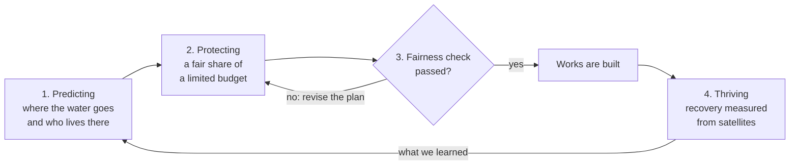

# THRIVE

**Trustworthy Hazard-to-Recovery Intelligence for Vulnerability-aware Equity**

**Dimitrios Sargiotis** · National Technical University of Athens · [users.ntua.gr/dims](https://users.ntua.gr/dims/) · [uomoathens.github.io](https://uomoathens.github.io/)

**[Try the interactive version →](https://uomoathens.github.io/thrive/)**

THRIVE is the companion software to the book *AI for Resilient Cities: Predicting, Protecting, and Thriving in a Changing Climate* (Springer, Cham, 2027, [link.springer.com/book/9783032364166](https://link.springer.com/book/9783032364166)). It takes the three verbs in the title and turns each into a question.

Predicting asks where the next flood will hit and who lives there. Protecting asks who gets protected first when the money for flood works runs out, as it always does. Thriving is the question most systems skip. After the water goes down, which neighbourhoods are back on their feet within weeks, and which are still waiting months later?

THRIVE answers the three in a loop, so that what we learn after one flood changes how we spend before the next.

## Status


The package skeleton, the tests and the automatic checks on GitHub are in place (version 0.1.0). The methods themselves are not written yet, so there are no results. The charts below show published figures or simple examples, and each caption says which. Every new step adds code with its own tests, and every number will be reproducible.

To try what exists so far:

```
pip install -e ".[dev]"
pytest
thrive info
thrive cite
```

`thrive info` lists the four steps of the loop and the frameworks of the book each one builds on. `thrive cite` prints the citation of the book.

## The problem

Disasters are getting more expensive. In the EU, weather and climate extremes such as floods, storms, heatwaves and droughts cost €8.5 billion a year on average in the 1980s. Between 2020 and 2023 the yearly average was €44.5 billion.

<picture>
  <source media="(prefers-color-scheme: dark)" srcset="docs/figures/eu-losses-dark.svg">
  
</picture>

In the United States, studies find that the money for protection is shared out in a way that tends to favour the richer side of town. Flood-mitigation projects funded by FEMA must pass a benefit-cost test, and the benefits it counts are mostly the property value a project protects. Zachary Liscow of Yale gives a simple example. Two levees cost $10 million each. Levee A protects 50 homes worth $210,000, so it saves $10.5 million and passes. Levee B protects 100 homes worth $90,000. It saves $9 million and fails, though it protects twice as many homes.

Economists have a fix called equity weights: a dollar saved counts for more when the household that saves it has less. In our illustration, which assumes income follows home value, the weights turn the result around.

<picture>
  <source media="(prefers-color-scheme: dark)" srcset="docs/figures/two-levees-dark.svg">
  
</picture>

Europe has noticed the problem. The proposed European Climate Resilience Law (COM(2026) 730, 27 October 2026) defines *just resilience* and asks every national climate-resilience plan to take into consideration people in vulnerable situations and the regions hit hardest. As we read the text, it sets out no method for checking that a plan does this. THRIVE is meant to give a public authority that check. If a system like it is classed as high-risk under the AI Act, the same check also documents the examination for possible bias that Article 10 requires.

## How the loop works



Each step builds on frameworks from the book:

| Step | Frameworks of the book it builds on |
| --- | --- |
| Predicting | HEFF-RC (Table 1.6), LSTM-AFFUW (Table 1.7), AIF-EWS (Table 1.8), VAE-LVM (Table 4.8) |
| Protecting | EA-CURA (Table 3.5), FCFL (Table 5.8), DPFL-EDA (Table 1.5) |
| Fairness check | The audit method of [Who Gets Help First?](https://github.com/uomoathens/who-gets-help-first) |
| Thriving | A new step that extends the social-impact feedback layer of EA-CURA |

## What THRIVE adds

### Recovery is measured, and no single definition of it is trusted

Satellites can see a town come back to life. Lights return at night (NASA Black Marble), and on farmland the fields turn green again (Sentinel-2). To compare two areas you have to decide what "recovered" means, say 90 % of normal light. That choice matters more than it seems. A 2026 preprint on Winter Storm Uri in Texas, not yet peer-reviewed, found that its answer to "do more vulnerable areas recover more slowly?" flipped when the definition changed.

The invented curves below show how that can happen.

<picture>
  <source media="(prefers-color-scheme: dark)" srcset="docs/figures/recovery-definition-dark.svg">
  
</picture>

THRIVE therefore checks every finding about unequal recovery under a range of thresholds, and keeps it only if it holds under all of them.

### Need may count, identity may not

A person over 80 should move a household up the list. So should a wheelchair user, a baby or a patient on dialysis. A foreign name, a woman's name or a poor postcode should not, once the need is the same. Our earlier audit found open language models breaking this rule in a quiet way: they moved Syrian names and asylum seekers up and areas of villas down, as if identity were a sign of need. THRIVE writes the rule down as a condition that every allocation has to meet.

### People count, not just property

THRIVE uses equity weights inside the allocation itself. How much more a euro counts for a poorer household is a political choice, so THRIVE never fixes the number. It shows an elected council what each choice would mean and leaves the decision to them.

### Nothing is built before a fairness check

Before a plan is used, THRIVE runs it again many times, changing one detail each time: a name, a neighbourhood, a residence status. A placebo run with nothing changed shows how much the plan moves by chance. If any detail moves it more than chance does, the plan fails. It also fails if adding a real need, such as a person over 80, does not move it.

### Small towns can learn without handing over their data

A village of 2,000 people has too little data to train a model on its own. With federated learning it can learn from larger towns while every town keeps its data on its own servers. THRIVE works with areas, the 1 km squares of the 2021 census, so bias can be checked without sensitive personal data.

### A language model explains, and never decides

A language model may help explain a decision to residents. It should not take one. In our earlier study, five small open models (7 to 8 billion parameters, run in 4-bit form) were given a clear priority rule for flood calls, and most of the time they did not keep it. Larger models may behave differently, and that is still to be tested.

<picture>
  <source media="(prefers-color-scheme: dark)" srcset="docs/figures/priority-rule-dark.svg">
  
</picture>

## How we will test it

| Phase | Where | Data |
| --- | --- | --- |
| A | United States, fully open | OpenFEMA Hazard Mitigation Assistance projects, CDC Social Vulnerability Index, NASA Black Marble |
| B | Thessaly, Storm Daniel (September 2023) | Copernicus EMS maps EMSR692 and EMSN184, 2021 census on the 1 km grid, Sentinel-2, NASA Black Marble |
| C | Thessaly, who actually received aid | Anonymised state-aid records by community, requested from the General Secretariat for Natural Disaster Recovery and State Aid |
| D | Attica, looking ahead | The current plan for flood and wildfire works, assessed before the next event |

We cannot rerun history, so some limits should be stated now. Phase B can show whether the real allocation after Daniel was unequal. Comparing it with what THRIVE would have done rests on assumptions, which we will state. Showing that a fairer allocation would also have reduced the damage needs hydraulic models of the floods with and without the works.

## The maths, for those who want it

**Recovery equity.** Group $g$ has recovered at threshold $\alpha$ on the first day its light reaches $\alpha$ times its level before the event. The penalty is the spread of recovery times between groups, taken at the worst threshold in the set $\mathcal{A}$:

```math
\tau_g(\alpha)=\min\left\{t:\ \mathrm{NTL}_g(t)\ge \alpha\,\mathrm{NTL}_g^{\mathrm{pre}}\right\},\qquad \Phi_{\tau}=\max_{\alpha\in\mathcal{A}}\ \sum_{g=1}^{G}\left|\tau_g(\alpha)-\bar{\tau}(\alpha)\right|
```

**Need, not identity.** With need $N$ held fixed, changing identity $A$ must not change the decision $\hat{Y}$:

```math
P\left(\hat{Y}_{A\leftarrow a}=y \mid X=x,\ N=n\right)=P\left(\hat{Y}_{A\leftarrow a'}=y \mid X=x,\ N=n\right)\quad \forall\, a,a'
```

**People, not property.** The reward of the allocation policy counts avoided expected annual loss $\Delta\mathrm{EAL}_i$ with an income weight $\omega_i$, and subtracts the recovery penalty. The policy is trained with Proximal Policy Optimization and the group-fairness penalty of FCFL:

```math
R_t=\sum_{i}\omega_i\,\Delta\mathrm{EAL}_i(a_t)-\kappa\,\Phi_{\tau},\qquad \omega_i=\left(\frac{\bar{y}}{y_i}\right)^{\eta}
```

**The fairness check.** A plan is released only if no identity change $c$ moves it beyond the placebo flip rate, and every need change does:

```math
\mathrm{Deploy}\iff \max_{c\in\mathcal{C}_{\mathrm{id}}}\left(\mathrm{FR}_c-\mathrm{FR}_{\mathrm{placebo}}\right)_{\mathrm{UB}_{95}}\le\delta\ \wedge\ \min_{c\in\mathcal{C}_{\mathrm{need}}}\mathrm{Sens}_c\ge\gamma
```

$\mathrm{FR}$ is the share of runs in which the plan changes, $\mathrm{UB}_{95}$ the upper end of its 95 % cluster-bootstrap interval after Holm correction, and $\mathrm{Sens}$ the share of need changes that raise the target's priority.

## Sources for the charts

- European Environment Agency, *Economic losses from weather- and climate-related extremes in Europe*, 8th EAP headline indicator, 2024.
- Z. Liscow, *Benefit-Cost Analysis and Equity*, NBER, 2023.
- J. W. Lockwood, M. Oppenheimer, N. Lin and J. Gourevitch, *Socioeconomic distributional impacts of evaluating flood mitigation activities using equity-weighted benefit-cost analysis*, Environmental Research Letters, 2024.
- Headwaters Economics, *Improving benefit-cost analyses for rural and low-income communities* (FEMA benefit-cost analysis and property values).
- European Commission, *Proposal for a European Climate Resilience Law*, COM(2026) 730, 27 October 2026, Articles 2(7), 7(1) and 7(2).
- *Spatial Patterns of Post-Storm Recovery Revealed by Nighttime Lights: Evidence from Harris County, Texas*, preprint, Preprints.org, September 2026.
- D. Sargiotis, *Who Gets Help First?*, v1.0.0, 2026, [doi:10.5281/zenodo.23684889](https://doi.org/10.5281/zenodo.23684889), results in `results/study-cpu`.

## Layout

```
README.md          this page
pyproject.toml     package definition
src/thrive/        the THRIVE package
tests/             tests, run on every push by GitHub Actions
.github/workflows/ the automatic checks
docs/index.html    the interactive version, published with GitHub Pages
docs/figures/      the charts on this page, in light and dark versions
docs/og.png        the preview image shown when the page is shared
CITATION.cff       how to cite this repository and the book
LICENSE            MIT
```

## Citation

The book:

> Sargiotis, D. (2027). *AI for Resilient Cities: Predicting, Protecting, and Thriving in a Changing Climate*. Springer, Cham. ISBN 978-3-032-36416-6 (hardcover), 978-3-032-36417-3 (eBook). https://link.springer.com/book/9783032364166

The related audit:

> Sargiotis, D. (2026). *Who Gets Help First? A counterfactual audit of large language model decisions in flood response* (Version v1.0.0) [Computer software]. Zenodo. https://doi.org/10.5281/zenodo.23684889

See also [CITATION.cff](CITATION.cff).

## Licence

Code: MIT.

## Author

Dimitrios Sargiotis, National Technical University of Athens.
